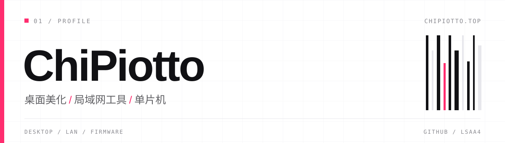

  

  
  &nbsp;&nbsp;
  
  &nbsp;&nbsp;
  

 

P I N N E D

  
    
  
    
  

 

  <a href="https://chipiotto.top/">chipiotto.top</a>
  &nbsp;·&nbsp;
  <a href="https://github.com/lsaa4">github</a>

还有一些，不在这里。

